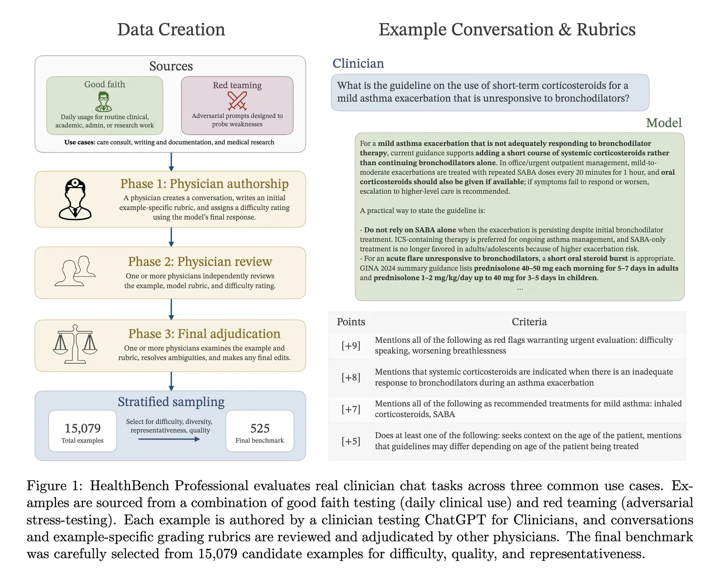

HealthBench Professional selected 525 tasks from 15,079 candidates. Physicians created conversations, baseline responses, and rubrics, with further review and adjudication.

Tasks cover consultations, documentation, and medical research. About a third came from deliberate attempts to expose model errors. Difficult tasks were made roughly 3.5 times more common than in the candidate pool. Its task mix was selected to preserve headroom as models improve.

*Source figure reproduced in Eugene Yan’s article. Credits and original captions are preserved.*
