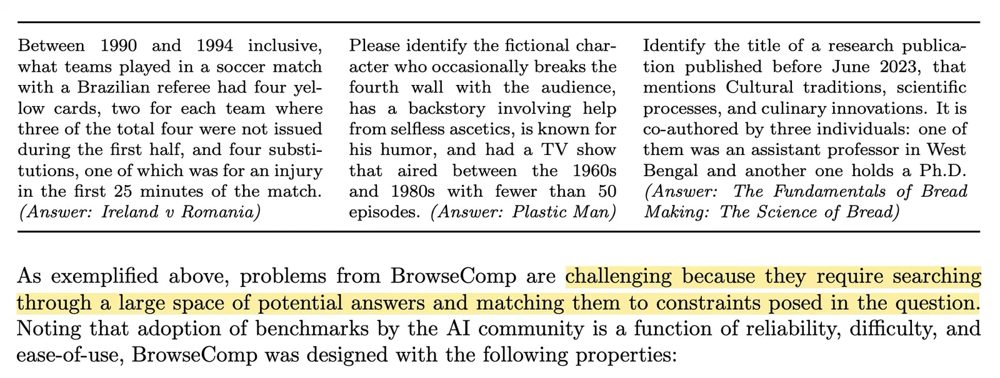

BrowseComp’s authors start with an entity and combine clues that point to it. Finding the entity can require a broad search, while checking a proposed answer takes only a few lookups.

The 1,266 questions were filtered to challenge the strong browsing models available at construction. Authors added constraints to make an answer seem unique. That confidence still needs checking when another plausible answer fits the clues.

*Source figure reproduced in Eugene Yan’s article. Credits and original captions are preserved.*
