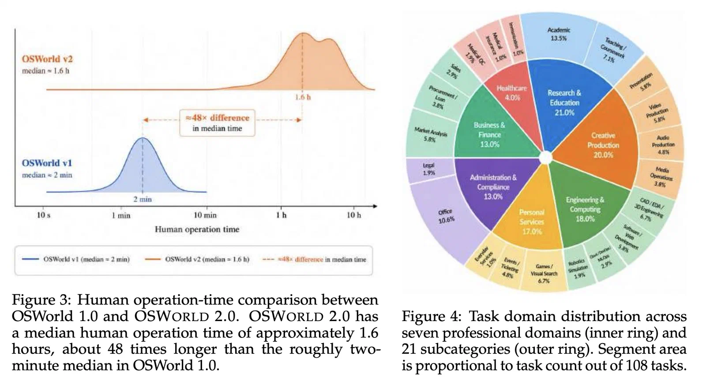

OSWorld 2.0 includes 108 desktop workflows across seven professional domains. Skilled humans need a median of about 1.6 hours per task.

An Ubuntu virtual machine supplies files, apps, and self-hosted websites. Agents operate through screenshots and mouse or keyboard actions, with a 500-step budget. Self-hosting limits changes and blocking from live services, while introducing an environment whose own state also needs verification.

*Source figure reproduced in Eugene Yan’s article. Credits and original captions are preserved.*
