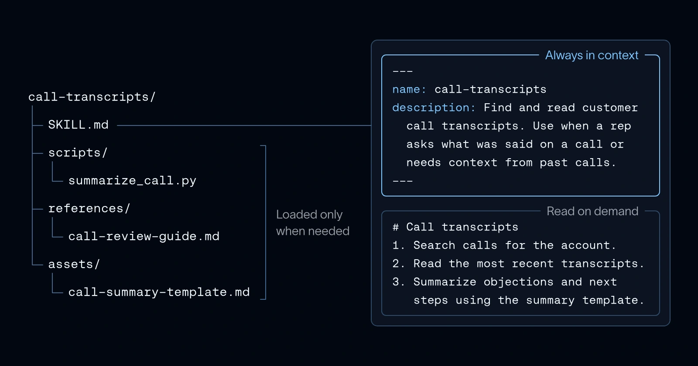

Keep a short menu of skill names and descriptions in context. Read a skill’s full instructions only when the task needs it. Load scripts and references after that.

This staged approach lets an agent use a large library without reading all of it on every call. The article adds tools to that pattern: a skill can bring in the capabilities needed to follow its instructions.

*Source: LangChain’s article. Tap to enlarge; the complete figure is preserved.*
