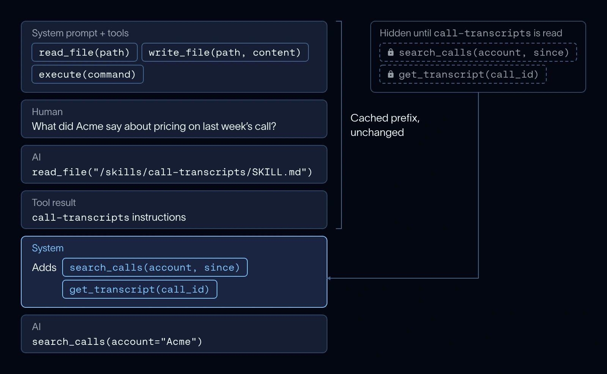

Newer Anthropic and OpenAI models can accept tools disclosed during a conversation. For those models, Deep Agents adds the bound tools after the skill is read without changing the earlier cached prefix.

Other models still receive additions through the request’s tool list, which can invalidate the cache. The caching benefit depends on provider and model support; deferred disclosure is not automatically cache-preserving everywhere.

*Source: LangChain’s article. Tap to enlarge; the complete figure is preserved.*
