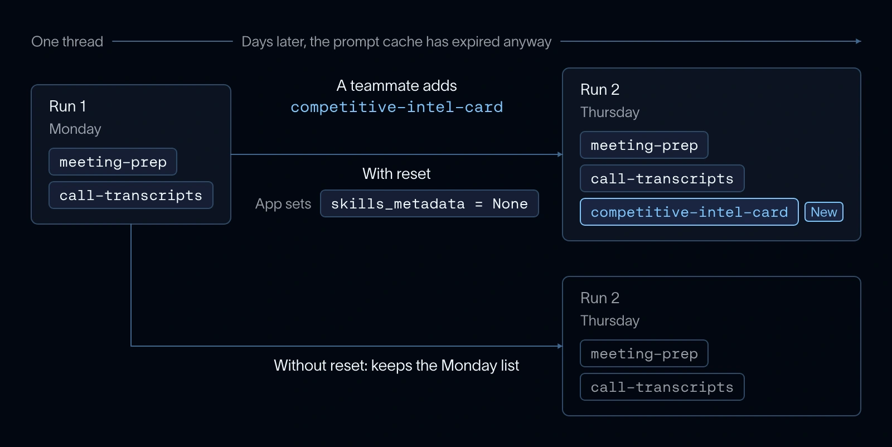

Deep Agents stores skill metadata in agent state so later turns normally reuse the same library discovered at thread startup. Setting skills_metadata to None invalidates that snapshot.

On the next run, the middleware rescans the sources and discovers additions, edits, or deletions. The application decides when to refresh, avoiding a requirement to discard a long-running thread whenever someone updates a skill.

*Source: LangChain’s article. Tap to enlarge; the complete figure is preserved.*
