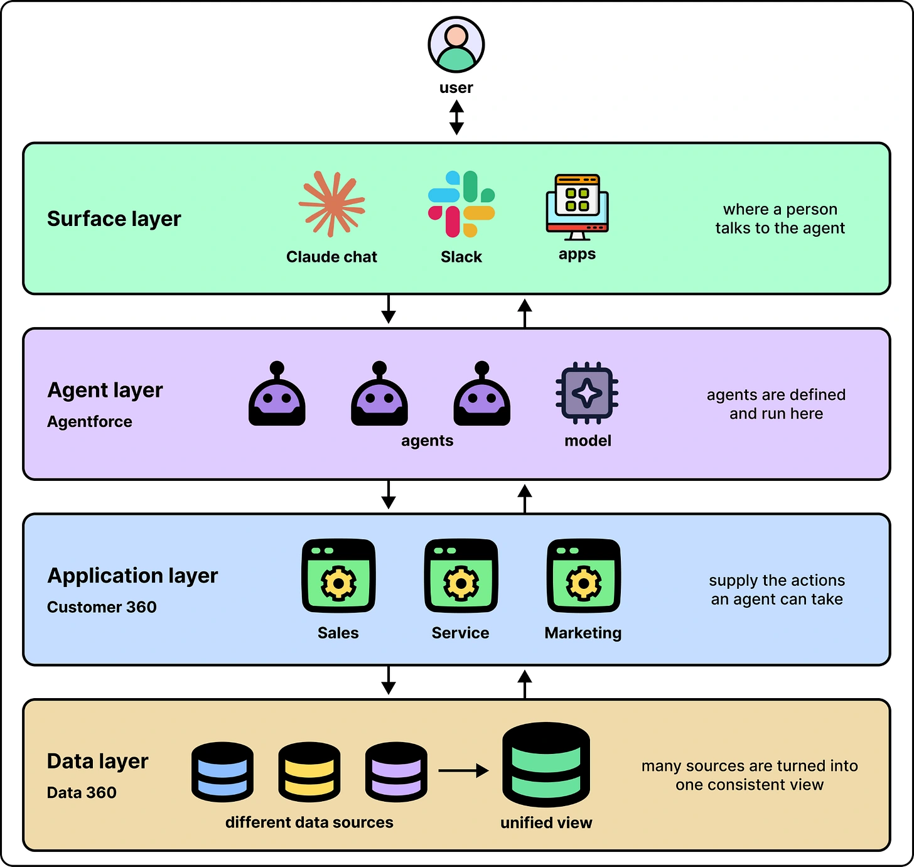

Salesforce separates the platform into four layers:

- **Surfaces:** interfaces such as Slack and Claude.
- **Agentforce:** where agents are defined and run.
- **Customer 360:** business applications and actions.
- **Data 360:** a consistent view of company records.

Each layer has a different job. The model can reason over prepared context while other systems handle data, actions and enforceable rules.

*Source: ByteByteGo’s article. Tap to enlarge; the complete figure is preserved.*
