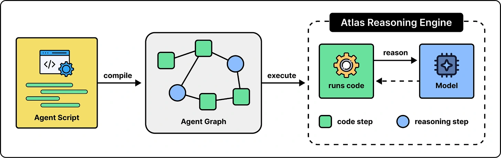

Agent Script puts predictable steps into code. It compiles into an **Agent Graph**, which the Atlas Reasoning Engine executes.

In the article’s appointment example, a `before_reasoning` block fetches appointments before the model answers. An `after_reasoning` block handles the next step. The lookup runs because it is part of execution, rather than because the model remembered a prompt instruction. Use natural language for the judgment that remains.

*Source: ByteByteGo’s article. Tap to enlarge; the complete figure is preserved.*
