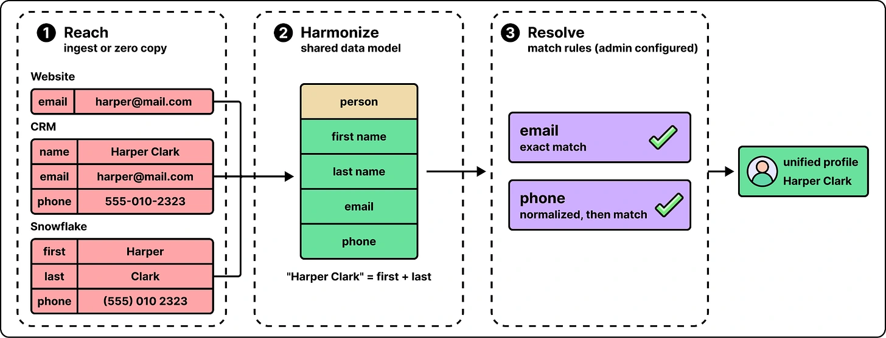

A customer may appear in a website database, a CRM and a warehouse. **Data 360** links those records into one profile.

It reaches the sources, maps fields to a shared shape and applies configurable identity-matching rules. The article shows exact email matching and normalized phone numbers as examples. The unified profile links back to the underlying records; it does not rewrite them just to make the match.

*Source: ByteByteGo’s article. Tap to enlarge; the complete figure is preserved.*
