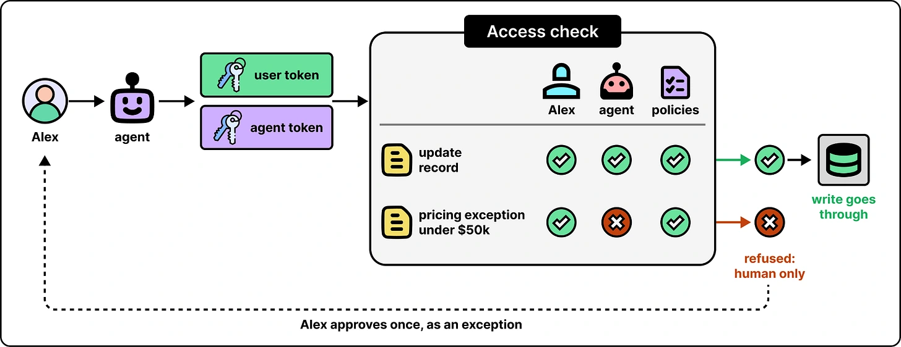

Give the agent its own identity and permissions, alongside the user’s identity. An operation must fit both sets of permissions and the applicable policies.

The article describes checks using separate user and agent tokens. This makes it possible to allow a person to perform an action while withholding the same action from an agent acting for them. The model’s instructions do not grant access.

*Source: ByteByteGo’s article. Tap to enlarge; the complete figure is preserved.*
