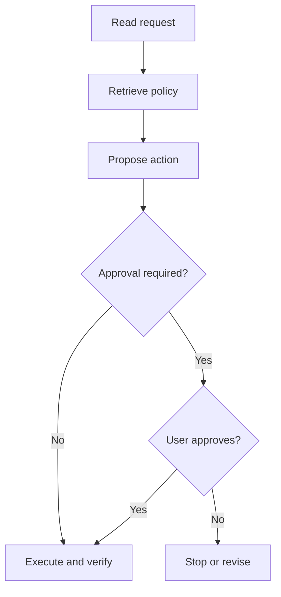

**Illustrative example**

A support agent reads the request, retrieves policy, proposes an action and checks whether approval is needed. Draw those steps and their failure paths first.

Now decide where a model adds useful interpretation. A visible structure makes missing permissions, recovery and evidence easier to notice than one large prompt that asks the model to handle everything.

*Added explanatory diagram.* [Editable diagram](diagrams/example-14.mmd) · [Portable image](images/example-14.svg)
