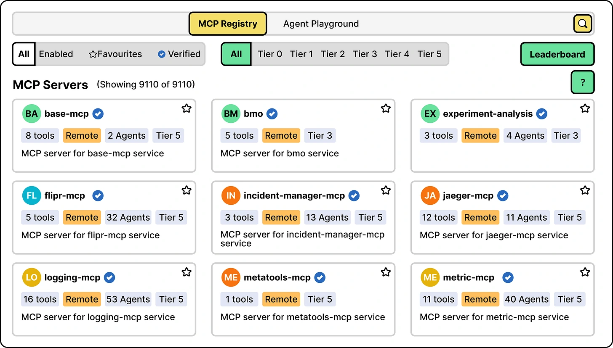

Uber separates two jobs:

- The **control plane**, including the Registry, keeps catalog and configuration information.
- The **data plane**, including the Proxy Gateway, handles live requests.

Agents and owners can discover tools through the catalog while actual calls take a controlled execution path. This keeps discovery, configuration and runtime handling connected without making them the same responsibility.

*Source: ByteByteGo’s article; credited to Uber Engineering in the article. Tap to enlarge; the complete figure is preserved.*
