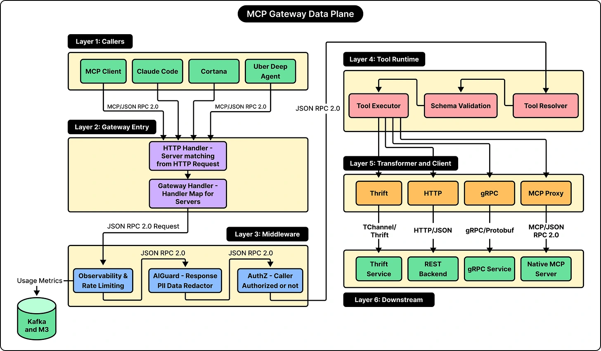

A shared MCP interface can sit in front of services that speak different protocols. Uber’s gateway translates requests and responses for HTTP, gRPC and TChannel backends.

Periodically refreshed mappings create virtual MCP endpoints for those capabilities. An agent uses the common tool interface while the gateway handles the service-specific transport. The source diagram shows the path through middleware, validation, execution and translation.

*Source: ByteByteGo’s article. Tap to enlarge; the complete figure is preserved.*
