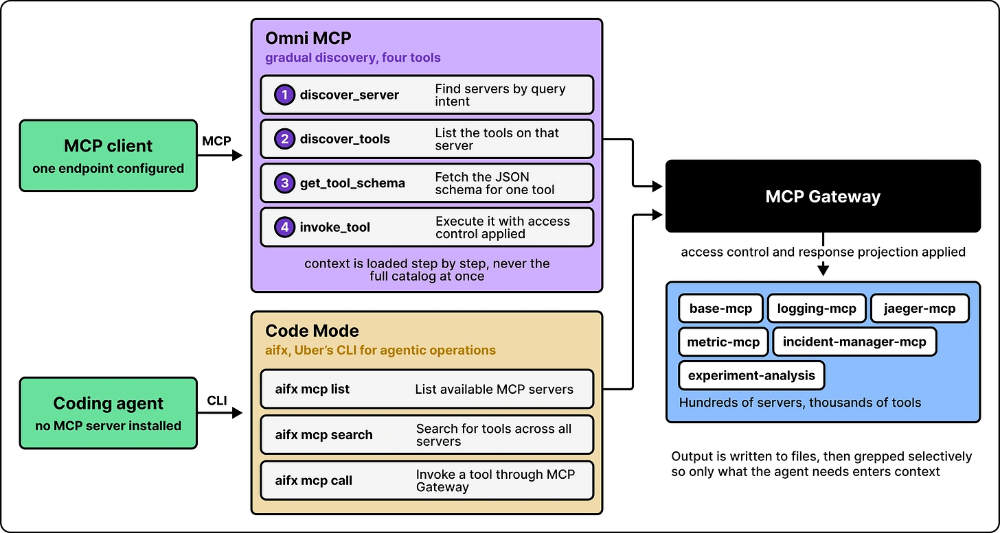

A large tool catalog does not have to fill the model’s context. **Omni MCP** discovers capabilities gradually, loading detail as the task needs it.

Response Projection returns selected fields instead of every part of a result. Code Mode lets coding agents work with results through files and shell commands. Together, these approaches keep the working context focused while leaving deeper information within reach.

*Source: ByteByteGo’s article; credited to Uber Engineering in the article. Tap to enlarge; the complete figure is preserved.*
