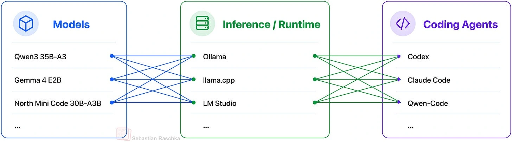

A local coding agent has several parts. The **model** generates decisions and text. The **runtime** serves that model. The **harness** connects it to files, tools and the development loop.

Raschka’s article compares combinations of these pieces. Changing only the harness can change the result, even with the same model. Test the whole setup on real work.

*Source: Sebastian Raschka’s article; paper credits remain in the original diagram. Tap to enlarge; the complete figure is preserved.*
