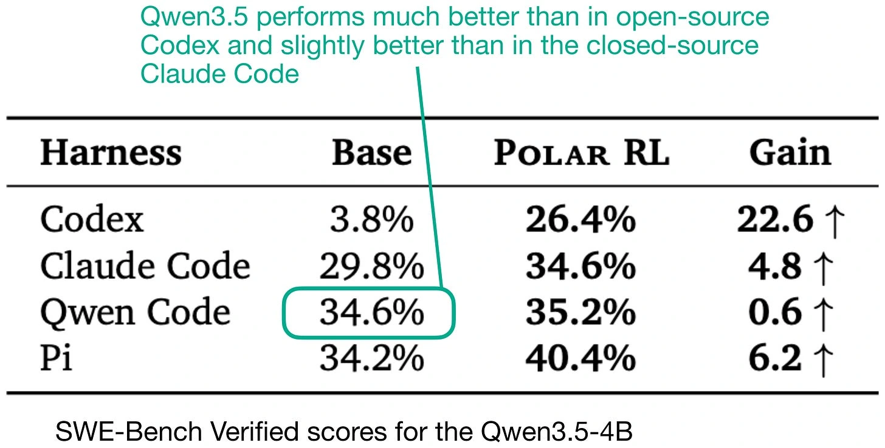

Raschka starts with Qwen Code because it is open source, can run alongside his usual Codex setup, and may suit Qwen models particularly well.

He cites a Polar benchmark in which Qwen3.5-4B performed best in Qwen Code. Extending that result to Qwen3.6 is an assumption, not a demonstrated fact. Later experiments in the article complicate the idea that a model’s own harness must always be the best choice.

*Source: Sebastian Raschka’s article; paper credits remain in the original diagram. Tap to enlarge; the complete figure is preserved.*
