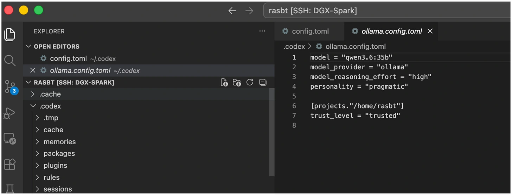

Raschka keeps a local Codex configuration separate from his usual hosted setup. His example selects `qwen3.6:35b`, the `ollama` provider, high reasoning effort and a pragmatic personality. He launches it with:

```bash
codex --profile ollama
```

The article abbreviates the provider and profile wiring. Treat this as a setup outline, rather than a complete configuration guaranteed to work unchanged in every CLI version.



*Source: Sebastian Raschka’s article; paper credits remain in the original diagram. Tap to enlarge; the complete figure is preserved.*
