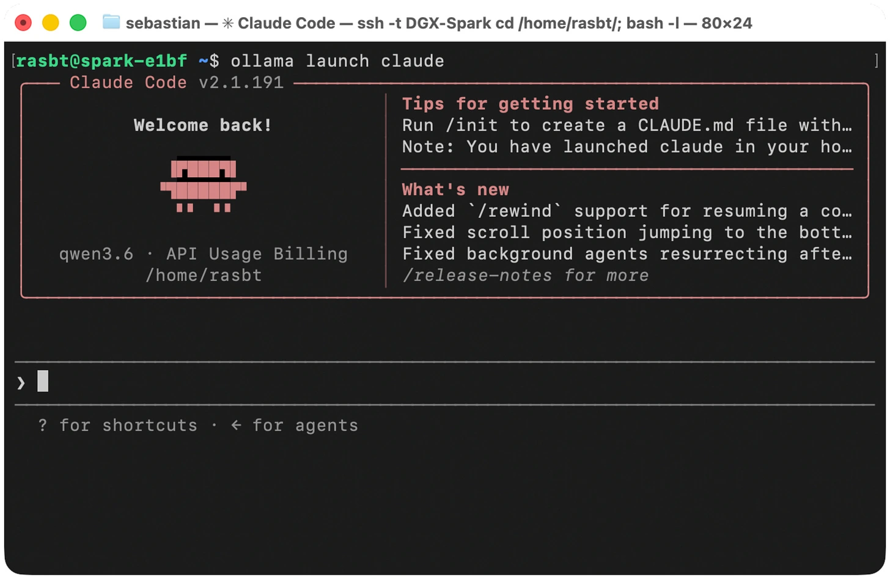

Ollama provides a Claude Code integration through `ollama launch claude`. The article also notes `ollama launch codex`, although Raschka prefers a separate Codex profile for visibility and control.

Claude Code is his least favored local option because its proprietary codebase limits inspection of data logging. Using a local model changes the inference endpoint; it does not make the surrounding proprietary harness open source or establish that all of its activity stays local.

*Source: Sebastian Raschka’s article; paper credits remain in the original diagram. Tap to enlarge; the complete figure is preserved.*
